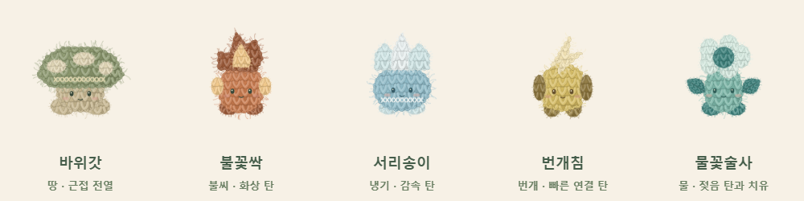

# 꾹꾹 디펜스 · Squish Born

재질마다 다른 볼을 누르고 떼어 털실 동료를 부화시키고, 작은 정원을 지키는 자동 디펜스입니다. 바삭·쪼물·팝·버터·키캡·꿀·초콜릿·탄산·공기빼기 9종을 만지며 Good·Perfect·무결점 보상과 동료 도감을 모읍니다.

**[바로 플레이 · Play](https://byh-playground.github.io/squish-born/)** · **0.14.0** · [단일 HTML 프리뷰](https://byh-playground.github.io/squish-born/index.html)



Press, hold and release textured balls to hatch yarn companions in a cozy auto-defense game. Nine materials reward different timing. Practice without combat or defend the garden with an elemental companion party.

## 조작·실행

- PC 마우스 / 터치: 볼의 금·주름·기포를 눌렀다 재질에 맞는 순간 놓습니다. 공기빼기볼은 가운데를 꾹 눌러 거의 납작해질 때 놓습니다.
- Space / 1: 현재 목표 위치 보조. 누르는 시간은 직접 조절합니다. P / Esc 또는 상단 일시정지 버튼으로 쉽니다.
- 처음 화면에서 정원 방어 또는 전투 없는 연습을 선택합니다. 도감·소리 설정은 상단에서 엽니다.

빌드가 필요 없습니다. 실행 파일은 **index.html 하나**이며 공식 GameKit 두 모듈과 녹음 음원까지 내장합니다. Node.js 22 이상에서:

```sh
npm run dev
# http://127.0.0.1:8767
npm ci
npm run check
npm test
npm run test:growth
npm run test:elements
```

Windows 검증은 설치된 Edge를 사용합니다. 다른 환경은 Playwright Chromium을 설치하고 BROWSER_CHANNEL=chromium을 지정합니다. TEST_URL로 공개 Pages에 같은 사용자 시나리오를 실행할 수 있습니다. 실행당 상한은 180초입니다.

## 0.14.0 · 도전 밖의 영구 성장과 군집 연쇄

완성 보상과 웨이브 보상으로 얻은 **조개**를 모아 다음 도전을 준비합니다. 패배·도전 종료·새로고침에도 잔액과 성장이 남습니다. 처음 화면과 결과 화면의 **정원의 성장**에서 부화/연쇄/속성/방어 탭 → 미니 트리 → 선택 상세 → 명시적 구매로 진행합니다. 전투 중에는 조회만 가능하고 연습은 재화·도감·기록을 저장하지 않습니다.

- 부화장은 공격하지 않습니다. 시작 불꽃싹이 첫 방어를 맡으며, 영구 성장으로 바위갓의 시작 합류도 열 수 있습니다.
- 모든 원거리 동료의 사거리는 560입니다. 대형 이동 제한과 공격 범위를 분리해 적이 나타날 때부터 공격합니다. 바위갓의 근접 역할은 유지합니다.
- 기본 3회 튕김과 화상·감속·젖음/증기·빙결·전도는 처음부터 열려 있습니다. 성장으로 4회·5회 튕김, 피해 유지율과 연결 반경을 높입니다.
- 일반 적 36/60/90/132/180 + 보스 1명, 총 499명을 군집으로 상대합니다. HP 배율은 0.8/0.9/1/1.15/1.35로 조정했습니다. 실제 탄의 짧은 궤적·방향 고리·압축 타격을 보강하며 장식 실 파티클만 제한합니다.
- 9종 재질 조작·Good/Perfect 보상·직접 부화의 첫 두 역할과 셔플백·기존 도감 키는 유지합니다. 타워 전용 강화와 판 안의 구매는 제거했습니다.

노드 12개의 가격·효과·조건, 보상 저장과 시작 흐름, 물량 튜닝은 [성장·군집 전투 정의](docs/growth-combat.md), 속성의 실제 비행·반응은 [속성 전투 정의](docs/element-combat.md)에 있습니다. 수치는 Config에서 관리합니다.

`npm test`는 실제 마우스·390px 터치의 입력/완성/취소/과압/오디오/일시정지와 연습 저장 차단을 확인합니다. `npm run test:growth`는 기존 프로필에서 선택·구매·더블클릭·자연 패배·재시작·실제 방어 부화·즉시 새로고침을 확인합니다.

`npm run test:elements` 또는 `npm run test:chain-natural`은 실제 웨이브·HP·피해·이동을 사용합니다. 성공 Good 부화만 5초마다 제공하며 PC는 기본 3회, 390px은 성장 5회 튕김으로 499명과 보스를 끝까지 확인합니다. 130~144초 구간은 실제 시간으로 재생하며 다른 구간은 60Hz로 빠르게 진행합니다. 생성물은 `artifacts/element-combat/`에 남으며 자동 assertion 외에 실제 캡처·영상 프레임을 검토합니다.

`node tests/element-natural.e2e.cjs --serve`는 http://127.0.0.1:8772 에서 같은 130~144초 전투를 재생합니다. `npm run check`는 고정된 공식 SDK 해시와 ESM 구문을 확인합니다. 내부 경계와 부하 벤치마크는 개발 중 임시로 실행하며 영구 단위 테스트로 누적하지 않습니다.

이번 검증의 5웨이브 완주는 부화 성공을 일정하게 제공한 격리 시나리오입니다. 사람의 무보조 난이도, 실기기 모바일, 사람의 청취, 모든 재질/특성 조합과 장기 성장 경제는 미검증입니다. 정확한 head/merge SHA·성능 비교·공개 배포 확인은 이번 PR에 기록합니다.

## 검증·배포

[0.11.3 SDK 갱신 검증](docs/verification-gamekit031-local.json): 공식 모듈·manifest SHA-256, ESM 구문, 게임 코드 보존 검사는 PASS입니다. Linux Chromium은 시작 시 로컬 소켓 권한 오류로 차단되어 이번 버전의 브라우저 사용자 시나리오는 미실행이며, 사용자 요청으로 이번 호환 PATCH는 정적 검증을 기준으로 배포하며 실제 플레이 재검증은 추후로 남깁니다. 아래 기록은 각 과거 버전의 결과입니다.

[0.11.2 로컬 Edge 155 검증](docs/verification-name-local.json): 20개 PASS, 오류 0. [0.11.1 공개 Pages 검증](docs/verification-pages.json)도 같은 게임 흐름에서 20개 PASS입니다. 마우스·390×844 터치 압착, 조기 해제·취소·과압, Good 1명/무결점 3명 부화, 중복 보상 없음, 오디오 20개 버퍼·실제 출력 샘플, 도감·일시정지·재시작·저장 복원, 방어 웨이브를 확인했습니다. [모바일 화면](docs/squish-born-mobile.png).

물리 스마트폰·스피커 청취·5웨이브 전체 밸런스·9종의 모든 특성과 겹볼 조합은 이번 재검증 범위가 아닙니다. 멀티플레이 기능은 없습니다. 원본의 과거 검증 주장을 현재 PASS로 합산하지 않습니다.

PR CI는 실제 내장 SDK 해시와 ESM 구문을 검사합니다. main 병합 시 동일 index.html을 GitHub Actions Pages에 배포합니다. CI 구문 검사와 실제 브라우저 검증 기록은 별개입니다.

## 원본·공통 모듈·권리

원본 출처는 **왁뿌 부화장 0.11.0**입니다. 현재 정식 이름은 게임 화면·문서 제목·도움말·진단 모두 **꾹꾹 디펜스 / Squish Born**으로 맞췄으며, 그림·재질·조작·저장 키는 유지했습니다. [원본 출처·SHA-256](docs/origin.json) · [이번 수정과 구조 검토](docs/refactor.md) · [GameKit 고정 정보](docs/gamekit.json).

GameKit **v0.3.1** / dist **72b09b260edf9650353017acb49c06873fe9f5a1**의 공식 input·simloop를 그대로 내장합니다. 이전 pointer capture/listener와 자체 accumulator/rAF chain을 제거했습니다. 게임 판정·보상·전투는 하나의 Simulation, 각 재질은 WaxBall 하위 타입, 겹볼은 기존 재질을 조합해 상태를 소유합니다. 단독 로컬 플레이에 불필요한 네트워크·예측·호환 번들은 추가하지 않았습니다.

[음원 출처·CC0 확인](docs/audio-sources.md)을 읽어 주세요. 모든 기존 음원·그래픽 고지를 유지했습니다. 게임 전체에 MIT 등 새 라이선스를 임의 부여하지 않습니다. 공개됨이 별도 재사용 라이선스를 의미하지 않습니다.

[개발 규칙](https://github.com/byh-playground/bloom-reference/blob/006093adbbe27d2566a60ceacac1d544fd9e1978/rules/development.html) · [관리·검증 규칙](https://github.com/byh-playground/bloom-reference/blob/006093adbbe27d2566a60ceacac1d544fd9e1978/rules/project-management.html) · [UI/UX 규칙](https://github.com/byh-playground/bloom-reference/blob/006093adbbe27d2566a60ceacac1d544fd9e1978/rules/visual-ux.html)
