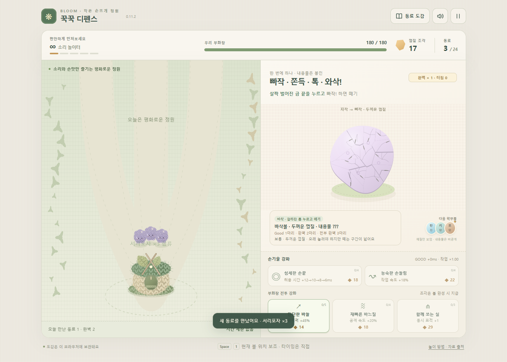

# 꾹꾹 디펜스 · Squish Born

재질마다 다른 볼을 누르고 떼어 털실 동료를 부화시키고, 작은 정원을 지키는 자동 디펜스입니다. 바삭·쪼물·팝·버터·키캡·꿀·초콜릿·탄산·공기빼기 9종을 만지며 Good·Perfect·무결점 보상과 동료 도감을 모읍니다.

**[바로 플레이 · Play](https://byh-playground.github.io/squish-born/)** · **0.12.1** · [단일 HTML 프리뷰](https://byh-playground.github.io/squish-born/index.html)



Press, hold and release textured balls to hatch yarn companions in a cozy auto-defense game. Nine materials reward different timing. Practice without combat or defend the garden together.

## 조작·실행

- PC 마우스 / 터치: 볼의 금·주름·기포를 눌렀다 재질에 맞는 순간 놓습니다. 공기빼기볼은 가운데를 꾹 눌러 거의 납작해질 때 놓습니다.
- Space / 1: 현재 목표 위치 보조. 누르는 시간은 직접 조절합니다. P / Esc 또는 상단 일시정지 버튼으로 쉽니다.
- 처음 화면에서 정원 방어 또는 전투 없는 연습을 선택합니다. 도감·소리 설정은 상단에서 엽니다.

빌드가 필요 없습니다. 실행 파일은 **index.html 하나**이며 공식 GameKit 두 모듈과 녹음 음원까지 내장합니다. Node.js 22 이상에서:

```sh
npm run dev
# http://127.0.0.1:8767
npm ci
npm run check
npm test
```

Windows 검증은 설치된 Edge를 사용합니다. 다른 환경은 Playwright Chromium을 설치하고 BROWSER_CHANNEL=chromium을 지정합니다. TEST_URL로 공개 Pages에 같은 사용자 시나리오를 실행할 수 있습니다. 실행당 상한은 180초입니다.

## 0.12.1 · 얼굴을 가리지 않는 매듭 연쇄

- 가시새싹의 실탄과 서리포자의 주표적 명중이 적에게 매듭 1개를 감습니다. 가까운 미표식 적을 우선하며 준비 공격·평타·부화장 바늘은 매듭을 기폭하지 않습니다. 서리포자의 기존 주변 둔화는 유지합니다.
- 단단버섯은 평타 3회 뒤 0.42초 동안 바늘을 들어 예고하고 4번째 강타로 매듭을 풉니다. 아래 세 바느질 표시가 공격 횟수를 보여 줍니다. 첫 두 성공 부화는 준비역→단단버섯, 나머지는 기존 다섯 역할 셔플백을 유지합니다.
- 얼굴 위 실 감기를 없애고 적의 오른쪽 아래 실루엣 밖에 작은 리본 매듭을 둡니다. 강타 예고 → 적과 매듭 압축 → 한 가닥 실이 풀려 다음 매듭으로 이동 → 받는 적의 압축/튕김 → 마지막 느슨한 실로 이어집니다. 실과 짧은 파열 표시는 캐릭터 뒤에 그리며, 7개 파편 구름을 제거했습니다.
- 110 거리 안의 가장 가까운 미사용 매듭 하나로만 이어지며 최대 5코입니다. 압축 7틱 + 전달 12틱 = 19틱(약 0.317초)으로 늘려 각 타격을 읽게 했습니다. 이전 11틱 대비 실제 피해 지연도 바뀌는 전투 타이밍 변경이며 피해량·반경·공격 주기·전파 조건은 유지합니다. 분기 전파는 없습니다.
- 매듭 피해 12, 반경 38 주변 피해 6, 금실은 각각 16.2/8.1입니다. 강타는 기존 평타의 1.6배입니다. 준비역이 많으면 매듭을 넓게 쌓고, 강타역이 많으면 짧은 연쇄가 자주 나옵니다. 소비한 매듭은 해당 연쇄에서 다시 쓰지 않습니다.
- 기존 3무리 완벽 연속 부화의 전장 실파동(13), 5무리 완벽 부화의 보스 실충격(42)은 그대로이며 연쇄를 시작하지 않습니다. 부화·자동 전투·재질 조작·저장 구조도 유지합니다.

`npm run check`는 SDK/구문 검사와 실제 Simulation 코드 기반 매듭 회귀 검사를 함께 실행합니다. `npm run test:knots`는 설치된 Edge에서 데스크톱/390px 공통 렌더를 검증하고 `artifacts/knot-chain/`에 장면/결과를 남깁니다. 이 격리 시연은 3무리 실제 체력(48.6), 정상 공격 수치와 고정 거리 55를 사용하며 위치 비교를 위해 적 이동과 부화장 사격만 멈춥니다. 12 준비 피해 + 평타 21 + 강타 11.2 뒤 첫 매듭이 4.4 체력에 도달해 연쇄를 열고, 후속 매듭은 36.6에서 12씩 피해를 받으므로 앞선 광역 피해가 전부 지우지 않습니다. 실제 볼 조작/취소/재시작은 기존 `npm test`로 별도 검증합니다. PC Edge 실검증과 CI 정적 검증은 구분해 기록합니다.

`npm run test:chain-natural`은 734123 seed의 실제 방어 웨이브를 390px/PC에서 재생하고 영상과 스크린샷을 `artifacts/natural-chain/`에 남깁니다. 0/12/24초의 Good 부화 보상만 입력하며 적 위치·이동·체력·스폰·부화장 사격을 조작하지 않습니다. 손으로 볼을 조작한 녹화는 아닙니다. `node tests/knot-natural.e2e.cjs --serve` 후 http://127.0.0.1:8771 에서 18–34초 구간을 반복해 눈으로 검토할 수 있습니다. 시뮬레이션은 저장을 구독하지 않으며 저장 불변을 검사합니다. 자동 검사는 미감 증명이 아닙니다. Linux Chromium은 socket 권한 오류로 실행되지 않아 실제 브라우저 검증은 아래 Windows Edge 결과를 사용했습니다.

### 0.12.1 실제 검증 · 2026-10-14

- Edge 155, PC/390px: `4328f2ff3dc23d375fd80217f170cd4a232ae680`에서 check(13개), 기존 입력 E2E, 격리 매듭 E2E, 자연 웨이브 영상/저장 불변 검사 PASS. 자연 전투에서 서로 다른 두 번의 3대상 연쇄를 확인했고 얼굴이 가려지지 않으며 실시간 모바일에서도 전달 순서를 읽었습니다.
- 후속 VFX만 바꾼 `9e20fd485c4296319e46825f0893ea5b5785dfde`에서 PC/390px 표적 검증 PASS: 오른쪽 아래 짧은 연결 실이 매듭을 실루엣에 붙이고 얼굴을 가리지 않음. 대상이 즉사해도 0.30초 수명의 별도 당김 반응이 남음(모바일에서 제거 후 0.267초 관찰). 저장 불변, 페이지 오류 없음. 후속 변경에 대해 전체 입력 E2E를 다시 돌린 것으로 합산하지 않습니다.
- 최종 실행 HTML: `0.12.1 / 20261014-squish-born-chain-rhythm-r2`, SHA-256 `1f3d0c99d0a398a9df33f57bb524e1a225ea38bc88a294e02670d83a4fa09ff6`. 최종 코드에서 SDK/구문/13개 Simulation 검사를 재통과했습니다.
- 물리 스마트폰, 사람의 스피커 청취, 5웨이브 전체 밸런스는 이번 검증 범위 밖입니다.

## 검증·배포

[0.11.3 SDK 갱신 검증](docs/verification-gamekit031-local.json): 공식 모듈·manifest SHA-256, ESM 구문, 게임 코드 보존 검사는 PASS입니다. Linux Chromium은 시작 시 로컬 소켓 권한 오류로 차단되어 이번 버전의 브라우저 사용자 시나리오는 미실행이며, 사용자 요청으로 이번 호환 PATCH는 정적 검증을 기준으로 배포하며 실제 플레이 재검증은 추후로 남깁니다. 아래 기록은 각 과거 버전의 결과입니다.

[0.11.2 로컬 Edge 155 검증](docs/verification-name-local.json): 20개 PASS, 오류 0. [0.11.1 공개 Pages 검증](docs/verification-pages.json)도 같은 게임 흐름에서 20개 PASS입니다. 마우스·390×844 터치 압착, 조기 해제·취소·과압, Good 1명/무결점 3명 부화, 중복 보상 없음, 오디오 20개 버퍼·실제 출력 샘플, 도감·일시정지·재시작·저장 복원, 방어 웨이브를 확인했습니다. [모바일 화면](docs/squish-born-mobile.png).

물리 스마트폰·스피커 청취·5웨이브 전체 밸런스·9종의 모든 특성과 겹볼 조합은 이번 재검증 범위가 아닙니다. 멀티플레이 기능은 없습니다. 원본의 과거 검증 주장을 현재 PASS로 합산하지 않습니다.

PR CI는 실제 내장 SDK 해시와 ESM 구문을 검사합니다. main 병합 시 동일 index.html을 GitHub Actions Pages에 배포합니다. CI 구문 검사와 실제 브라우저 검증 기록은 별개입니다.

## 원본·공통 모듈·권리

원본 출처는 **왁뿌 부화장 0.11.0**입니다. 현재 정식 이름은 게임 화면·문서 제목·도움말·진단 모두 **꾹꾹 디펜스 / Squish Born**으로 맞췄으며, 그림·재질·조작·저장 키는 유지했습니다. [원본 출처·SHA-256](docs/origin.json) · [이번 수정과 구조 검토](docs/refactor.md) · [GameKit 고정 정보](docs/gamekit.json).

GameKit **v0.3.1** / dist **72b09b260edf9650353017acb49c06873fe9f5a1**의 공식 input·simloop를 그대로 내장합니다. 이전 pointer capture/listener와 자체 accumulator/rAF chain을 제거했습니다. 게임 판정·보상·전투는 하나의 Simulation, 각 재질은 WaxBall 하위 타입, 겹볼은 기존 재질을 조합해 상태를 소유합니다. 단독 로컬 플레이에 불필요한 네트워크·예측·호환 번들은 추가하지 않았습니다.

[음원 출처·CC0 확인](docs/audio-sources.md)을 읽어 주세요. 모든 기존 음원·그래픽 고지를 유지했습니다. 게임 전체에 MIT 등 새 라이선스를 임의 부여하지 않습니다. 공개됨이 별도 재사용 라이선스를 의미하지 않습니다.

[개발 규칙](https://github.com/byh-playground/bloom-reference/blob/1ab53f97402638ae58ae8c77fba8d18530dea7d6/rules/development.html) · [관리·검증 규칙](https://github.com/byh-playground/bloom-reference/blob/1ab53f97402638ae58ae8c77fba8d18530dea7d6/rules/project-management.html) · [UI/UX 규칙](https://github.com/byh-playground/bloom-reference/blob/1ab53f97402638ae58ae8c77fba8d18530dea7d6/rules/visual-ux.html)
